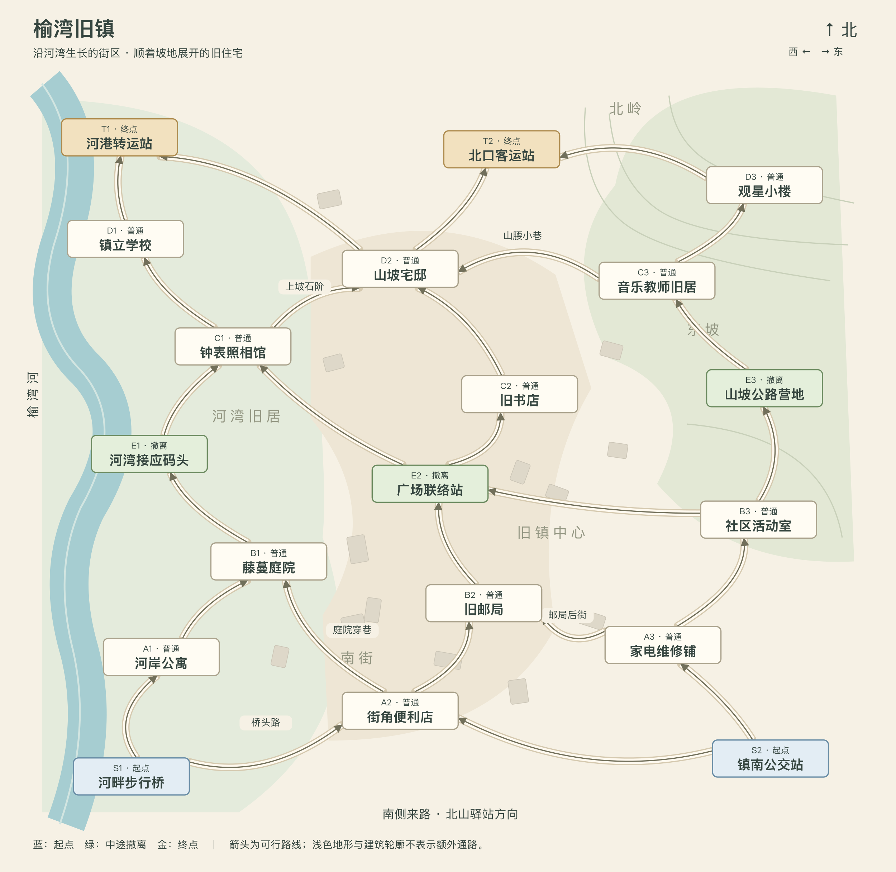

# 第三张探索地图：榆湾旧镇

状态：已同步到游戏内置目录与策划配置台。地图图像中的箭头、本文邻接表共同定义本版路线。

内容更新：节点掉落、路线门槛与时长、事件和首次撤离奖励已完成配表，详见 [榆湾旧镇收益配置](yuwan-town-balance.md)。本文保留拓扑设计过程；其中早期的空池或统一时长说明不再代表当前配置，以收益配置文档和内置目录为准。

## 不可违反的设计约束

以下为用户明确要求，后续改稿和实现必须遵守：

1. 延续前两图的地理和生活世界观；越高阶越接近旧文明人口中心，现代物品必须有合理的生活或设施背景。
2. 只呈现失落聚落的现状、生活痕迹和氛围，不指定交通改道、设施关闭等衰败原因。
3. 第三图比第二图节点更多，两个起点、两个终点，约十二个普通节点；中途撤离点控制在两到三个。本稿取三个，也满足此前中途撤离点多于终点的要求。
4. 必须设计完整场景平面布局，明确所有节点的空间位置、相对方位和实际联通关系；不能仅列地点名称。
5. 路线必须符合地理与场景逻辑，不同路径经过不同节点，连接起点与终点；空间相邻不自动等于可通行。
6. 中途撤离点不得靠近起点或终点；按沿实际可行路线经过的节点数计算，两侧距离大致相同，不能只看画面上的几何距离。
7. 平面图必须清楚标注所有节点与全部可行路径，图文一致。

本稿将第六条收紧为：所有完整路线都由七个节点组成，中途撤离固定为第四个；撤离前后各经过两个普通节点，到起点和终点各三条边。不存在跳层捷径或连接两个中途撤离点的路线。

## 背景

从北山驿站继续向北，山路渐渐变宽，路旁开始出现围墙、路灯与褪色的门牌。榆湾藏在树木与河湾之间。临街商铺、河岸住宅、学校，以及山坡上的房屋，仍保留着小镇完整的轮廓。窗后的生活仿佛已经离开很久，却仍能从摆设与字迹中辨认出来。

不解释小镇失落的原因。返程接应设施是如今探险者在旧镇边缘与中部维护的小型据点，不代表小镇已经恢复生活。

## 地理骨架

- 北在上、南在下；南侧连接北山驿站。西边是河流与平坦河岸，中间是旧商业街，东侧地势逐渐抬升为住宅坡地；北部是河港、学校与山坡建筑。
- 西南河畔步行桥是进镇入口，西侧河流来自克格纳方向。镇南公交站在东南公路入口。北口客运站是位于镇北边缘的另一处设施，与南侧站牌区分。
- 河岸公寓北接藤蔓庭院，庭院通过河岸步道抵达接应码头。便利店位于镇南街口，向北是邮局，再向北是广场。维修铺靠近南侧公路，向北进入社区活动室，再沿上坡路到公路营地。
- 撤离带北侧仍有两个完整探索阶段。码头北面的滨河旧街上是钟表照相馆，继续向北抵达学校与河港；广场北面是旧书店，书店背面的坡道通向山坡宅邸；东侧营地沿住宅巷抵达教师旧居，再上行到观星小楼。
- 山坡宅邸在北部坡地的西缘，与更东面的观星小楼是独立建筑。宅邸有向西下坡接河港的道路，也有向东北接北口客运站的道路。
- 学校位于较平坦的河岸北段，乐器旧居位于东侧生活区，观星小楼位于开阔高处。原方案“阁楼观星室”调整为独立的“观星小楼”，避免把同一建筑的室内房间画成远距离场景节点。

## 平面图与方位表

SVG 坐标原点在左上，x 向东增加，y 向南增加。本版采用河湾、曲街与坡地布局，不再将节点排列成等距行列；三个中途撤离点分散在西侧河湾、镇中广场和东北坡道，不处于同一条地理横线上。图中南北位置是地理示意，不表示实际路程或行进时长。下表列出每个节点的全部来路与出路及相对方位；未列出的方向没有可选路线。探索整体由南向北，局部沿河岸和山腰横向转折；按箭头推进，不回走；撤离所用外围道路与船只不属于继续探索的路线。

| 节点 | 类型 | 平面坐标 | 来路及方位 | 出路及方位 |
|---|---|---|---|---|
| S1 河畔步行桥 | 起点 | (220, 1300) |  | 北：A1 河岸公寓；东：A2 街角便利店 |
| S2 镇南公交站 | 起点 | (1290, 1270) |  | 西：A2 街角便利店；西北：A3 家电维修铺 |
| A1 河岸公寓 | 普通 | (270, 1100) | 南：S1 河畔步行桥 | 东北：B1 藤蔓庭院 |
| A2 街角便利店 | 普通 | (670, 1190) | 西：S1 河畔步行桥；东：S2 镇南公交站 | 西北：B1 藤蔓庭院；东北：B2 旧邮局 |
| A3 家电维修铺 | 普通 | (1110, 1080) | 东南：S2 镇南公交站 | 西：B2 旧邮局；东北：B3 社区活动室 |
| B1 藤蔓庭院 | 普通 | (450, 940) | 西南：A1 河岸公寓；东南：A2 街角便利店 | 西北：E1 河湾接应码头 |
| B2 旧邮局 | 普通 | (810, 1010) | 西南：A2 街角便利店；东：A3 家电维修铺 | 西北：E2 广场联络站 |
| B3 社区活动室 | 普通 | (1270, 870) | 西南：A3 家电维修铺 | 北：E3 山坡公路营地；西：E2 广场联络站 |
| E1 河湾接应码头 | 撤离 | (250, 760) | 东南：B1 藤蔓庭院 | 东北：C1 钟表照相馆 |
| E2 广场联络站 | 撤离 | (720, 810) | 东南：B2 旧邮局；东：B3 社区活动室 | 东北：C2 旧书店；西北：C1 钟表照相馆 |
| E3 山坡公路营地 | 撤离 | (1280, 650) | 南：B3 社区活动室 | 西北：C3 音乐教师旧居 |
| C1 钟表照相馆 | 普通 | (390, 580) | 西南：E1 河湾接应码头；东南：E2 广场联络站 | 西北：D1 镇立学校；东北：D2 山坡宅邸 |
| C2 旧书店 | 普通 | (870, 660) | 西南：E2 广场联络站 | 西北：D2 山坡宅邸 |
| C3 音乐教师旧居 | 普通 | (1100, 470) | 东南：E3 山坡公路营地 | 西：D2 山坡宅邸；东北：D3 观星小楼 |
| D1 镇立学校 | 普通 | (210, 400) | 东南：C1 钟表照相馆 | 北：T1 河港转运站 |
| D2 山坡宅邸 | 普通 | (670, 450) | 西南：C1 钟表照相馆；东南：C2 旧书店；东：C3 音乐教师旧居 | 西北：T1 河港转运站；东北：T2 北口客运站 |
| D3 观星小楼 | 普通 | (1280, 310) | 西南：C3 音乐教师旧居 | 西：T2 北口客运站 |
| T1 河港转运站 | 终点 | (200, 230) | 南：D1 镇立学校；东南：D2 山坡宅邸 |  |
| T2 北口客运站 | 终点 | (840, 250) | 西南：D2 山坡宅邸；东：D3 观星小楼 |  |

## 支路为什么相连

- B3→E2：社区活动室向西沿广场东街进入镇中心，可以在广场撤离或转入旧街。
- E2→C1：广场西北侧的滨河旧巷通到钟表照相馆，让中段之后仍能选择河岸方向。

- S1→A2：桥头入镇支路通到便利店；S2→A2：公交站向西北进入同一条商业街。两个起点都可进入中央街区，同时各保留一条侧翼路线。
- A2→B1：便利店西北的庭院穿巷连到河岸住区，属于向前转线。
- A3→B2：维修铺后的邮局后街通往旧邮局；也可沿东侧街道继续到社区活动室。
- C1→D2：照相馆旁的上坡石阶通向北部宅邸，形成河岸转向山坡的选择。
- C3→D2：教师旧居的山腰小巷向西北通到宅邸；向北则抵达观星小楼。
- D2→T1 / T2：北部坡地道路在宅邸外分岔，西北沿坡脚道路抵达河港，东北通往客运站。
- 空间相近的节点未必直接联通；未画线的部分由院墙、连续房屋、坡坎或缺少可靠通路的地带分隔。不把这些阻隔解释为某次具体灾难。

## 三条代表路线

1. 河岸线：河畔步行桥 → 河岸公寓 → 藤蔓庭院 → 河湾接应码头 → 钟表照相馆 → 镇立学校 → 河港转运站。
2. 镇中线：镇南公交站 → 街角便利店 → 旧邮局 → 广场联络站 → 旧书店 → 山坡宅邸 → 北口客运站。
3. 住宅线：镇南公交站 → 家电维修铺 → 社区活动室 → 山坡公路营地 → 音乐教师旧居 → 观星小楼 → 北口客运站。

可以通过指定斜向街巷转线，例如河岸入口经照相馆、山坡宅邸抵达北口客运站；公交站入口经便利店、藤蔓庭院抵达河港。不是两个入口各自绑定一个终点，也不是一次走遍所有地点。

## 撤离与终点的场景解释

- E1 河湾接应码头：位于镇中河湾，停靠探险者的返程接应船。继续探索则沿岸向北进入滨河旧街。
- E2 广场联络站：位于镇中心的临时接应处，由探险队通过外围通道接送；继续探索进入广场北面的书店街。
- E3 山坡公路营地：位于东西生活区与山坡的交界，有沿外围公路返程的接应；继续探索转入北侧住宅巷。
- T1 河港转运站：本段河岸线的北端，在这里完成探索并由预定接应船撤离。
- T2 北口客运站：本段陆路线的北端，从站外接应点离开。不意味着旧客运线路仍在运营。
- 中途撤离保持现有机制：可选择返程或继续；终点结束本次探索。起点仅承担入场选路，不是撤离点。

## 校验结果与实现边界

全图 19 个节点、26 条有向连线、32 条完整起终路线。已枚举全部路线：无孤立节点、无环路、无普通死路，两个入口各自均可到达两个终点；每条完整路线恰好经过一个中途撤离点，撤离点两侧均为两个普通节点、三条边。

节点坐标、连线、入口、终点、撤离标记已进入策划配置台。战利品与事件保持未配置；运行时无掉落节点直接进入选路或终点撤离。

## 第二版：自然布局修订

用户追加要求：避免过于整齐、工业化的排布；应根据场景地形调整节点位置与布局，允许为此增删节点。此要求同样作为后续改稿约束。

本版保留十九个节点，新增社区活动室到广场联络站的广场东街，以及广场联络站到钟表照相馆的滨河旧巷，重新安排全部位置：西侧河流向镇内弯入形成河湾，南街沿桥头到公交站弯曲展开；商业建筑较密，西北学校与东侧山坡住宅较疏。镇中广场位于邮局西北侧，书店位于广场东北侧；山坡营地在镇东北，地理位置比另外两个撤离点更靠北，但从起点到达它仍需经过两个普通节点。教师旧居到宅邸沿山腰向西绕行，宅邸到河港沿坡脚下降。地图不画整齐的区域色带和撤离横带，改用自然地形轮廓、曲线路径及少量非交互建筑轮廓。

节点数量不是上一版不自然的主要原因，因此本次未增删节点。几何位置和街道路程不再等距；撤离点的前后节点数仍保持一致。重新核对后，全部完整路线仍符合中途撤离前后各两个普通节点的要求。

## 游戏接入与策划配置

- 地图 ID：`map-3`；节点 ID 对应图中编号的小写形式，例如 `S1` → `m3-s1`。完整数据保存在 `src/domain/catalog.bundled.json`。
- 配置入口：开发环境 `?config=1` → 地图 → 榆湾旧镇。实际布局支持拖拽锚点，下方拓扑图支持点选节点和路线进行编辑；无底图时仍展示布局与连线。
- 通过“抵达北山驿站”任务解锁。已完成该任务的旧存档读档后补上解锁，不重复发放货币或物品。旧本地配置首次读取时增量补入地图、对应解锁关系与抽奖预算，保留原有策划修改；已迁移后不会强制恢复策划主动删除的地图。
- 入口支持多选，默认入口为河畔步行桥，另一入口为镇南公交站；玩家在出发准备阶段实际选择入口，所选入口随行进存档保存。
- 所有节点均未配置 `loot`、`eventPoolIds`、`firstExtractionRewards`，未新建任何战利品池或事件池。节点编辑器显示“尚未配置战利品”，由策划勾选后配置；只修改名称或路线不会生成默认掉落。

接入用的临时数值均保存在配置中，可直接在后台调整：

| 可配置项 | 当前默认值 |
|---|---|
| 各路线行进时长 | 每条 60 分钟，暂沿用第二图普通路线时长 |
| 非起始节点基础经验 | 30，暂沿用第二图 |
| 部分／完整情报感知 | 2／4 |
| 地图画布宽高比 | 1500 / 1460，与保留的 SVG 一致 |
| 节点位置 | SVG 坐标转换为 0～100%：x / 1500 × 100、y / 1460 × 100 |
| 每日抽奖第三图预算 | 金币 955、经验 29，暂沿用第二图预算；不修改抽奖物品池 |

出发准备仍使用全局固定 15 秒，不新增可配置耗时。第三图当前没有战利品，预算沿用避免解锁新图时意外改变已有抽奖体验；待配置掉落后可在抽奖后台重新估算。

## 底图制作资产保留

- `docs/maps/yuwan-town-map.svg`：保留完整矢量图，作为后续生成底图的地形、节点和路径参考；本次接入未改写此文件。
- `docs/maps/yuwan-town-map.png`：对应预览。
- `docs/maps/yuwan-town-map.html`：可浏览的矢量图。
- 游戏暂用节点与路线预览，尚未生成第三图的美术底图。制作底图时应保留画布比例与地物锚点；草图文字、节点框和箭头应作为参考图层，不绘入最终纯场景底图。
